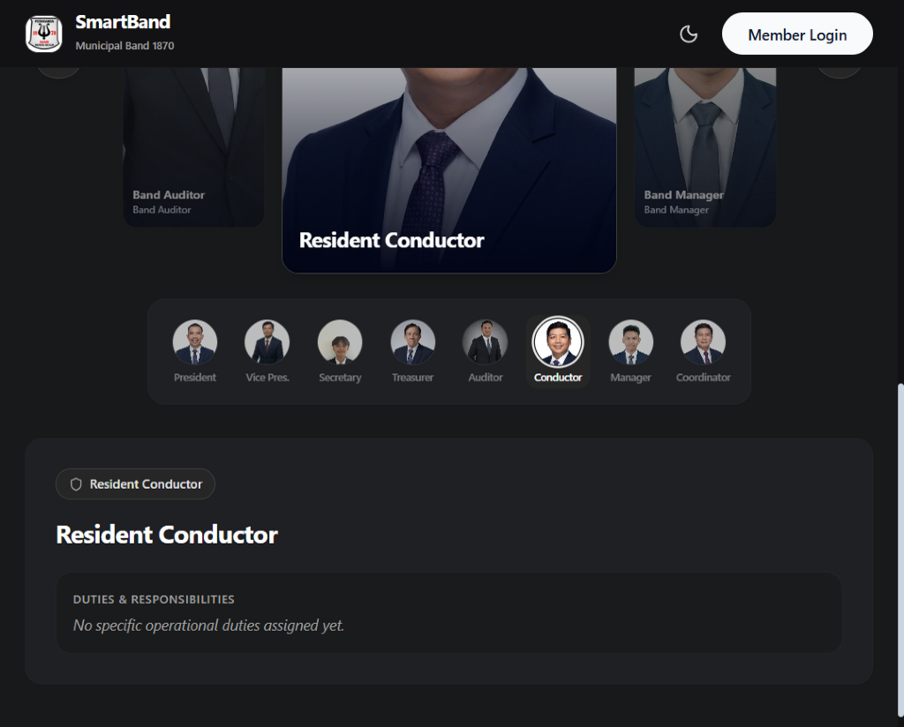

# Mark Piolo A. Morente — IT Portfolio

> Personal IT portfolio website for Mark Piolo A. Morente, a 4th-year BSIT student at Nueva Ecija University of Science and Technology (NEUST), Sumacab Campus.

**Live Site:** `https://kyoujin-pio.github.io/project-1/`  
**Author:** Mark Piolo A. Morente  
**Email:** morentemarkypiolo@gmail.com  
**LinkedIn:** [linkedin.com/in/mark-piolo-morente](https://linkedin.com/in/mark-piolo-morente)

---

## 🛠️ Tech Stack

| Layer       | Technology                     |
|-------------|--------------------------------|
| Markup      | HTML5 (semantic)               |
| Styling     | CSS3 (custom properties, Grid, Flexbox) |
| Scripting   | Vanilla JavaScript (ES6+)      |
| Icons       | Font Awesome 6                 |
| Fonts       | Google Fonts — Inter & Fira Code |
| Hosting     | GitHub Pages                   |

---

## 📁 Folder Structure

```
portfolio/
├── index.html        ← Main single-page site
├── style.css         ← All styles (dark navy + electric blue theme)
├── script.js         ← Interactivity (typed effect, animations, gallery, form)
├── README.md         ← This file
├── certificates/     ← Verified webinar & participation certificates (.pdf)
│   ├── cert-web-dev-101.pdf
│   ├── cert-ui-ux-101.pdf
│   ├── cert-ai-tools-101.pdf
│   ├── cert-emerging-it-innovations.pdf
│   └── cert-phinma-webinar-2026.pdf
└── images/           ← Project screenshots and profile photo
    ├── profile.jpg          (your profile photo)
    ├── band-pwa-1.png       (SmartBand PWA screenshot 1)
    ├── band-pwa-2.png       (SmartBand PWA screenshot 2)
    ├── ws03-1.png           (Prosple / WS03 Job Portal screenshot 1)
    ├── ws03-2.png           (Prosple / WS03 Job Portal screenshot 2)
    ├── ws03-3.png           (Prosple / WS03 Job Portal screenshot 3)
    ├── band-site-1.png      (Band Website screenshot 1)
    └── band-site-2.png      (Band Website screenshot 2)
```

---

## 🚀 Deploying to GitHub Pages — Step-by-Step

### Prerequisites
- A [GitHub](https://github.com) account (you already have `kyoujin-pio`)
- [Git](https://git-scm.com/downloads) installed on your computer

---

### Step 1 — Create the GitHub Repository

1. Go to [github.com/new](https://github.com/new)
2. Set **Repository name** to `portfolio`
3. Make it **Public**
4. Do **not** add a README (you already have one)
5. Click **Create repository**

---

### Step 2 — Initialize Git and Push the Files

Open a terminal (Command Prompt, PowerShell, or Git Bash) inside the `portfolio` folder:

```bash
cd c:\sirprince\portfolio

git init
git add .
git commit -m "Initial commit: IT Portfolio"
git branch -M main
git remote add origin https://github.com/kyoujin-pio/portfolio.git
git push -u origin main
```

---

### Step 3 — Enable GitHub Pages

1. On GitHub, go to your `portfolio` repository
2. Click **Settings** → **Pages** (in the left sidebar)
3. Under **Source**, select:
   - Branch: `main`
   - Folder: `/ (root)`
4. Click **Save**

GitHub will show you a URL like:
```
https://kyoujin-pio.github.io/portfolio/
```

> It may take **1–3 minutes** to go live the first time.

---

### Step 4 — Add Your Photos and Screenshots

1. Place your profile photo at `images/profile.jpg`
2. Place your project screenshots in the `images/` folder (see filenames above)
3. In `index.html`, replace each `<div class="screenshot-placeholder">` with a real `` tag:
   ```html
   <!-- Replace this: -->
   <div class="screenshot-placeholder"> ... </div>

   <!-- With this: -->
   
   ```
4. For your profile photo, replace the `<div class="avatar-placeholder">` block with:
   ```html
   
   ```

---

### Step 5 — Push Updates

After making any changes:

```bash
git add .
git commit -m "Update: add screenshots and profile photo"
git push
```

GitHub Pages will automatically rebuild and redeploy within 1–2 minutes.

---

## ✅ Customization Checklist

- [x] Add your profile photo (`images/profile.jpg`)
- [x] Add Project 1 (SmartBand PWA) with screenshot (`images/band-pwa-1.png`)
- [x] Add Project 2 (Prosple / WS03 Job Portal) with 3 screenshots (`images/ws03-*.png`) & GitHub repository
- [x] Add Project 3 (Peñaranda Band 1870 Official Website)
- [ ] Add remaining screenshots (`band-pwa-2.png`, `band-site-1.png`, `band-site-2.png`)
- [x] Add certifications & webinars (5 verified certificates in `certificates/`)
- [ ] Push to GitHub and enable GitHub Pages (`https://kyoujin-pio.github.io/portfolio/`)

---

## 📄 License

This project is for personal portfolio use. All content is owned by Mark Piolo A. Morente.
